

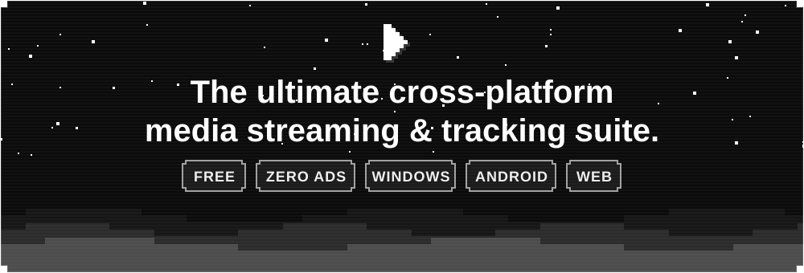

 

<a href="https://github.com/theSideQuestNPC/WatchWave/stargazers">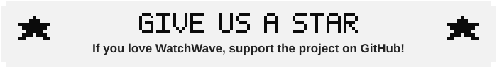</a>

  

  

WatchWave is a lightweight, modern, cross-platform media streaming and tracking suite built for seamless entertainment discovery. 
Available now as **Windows** and **Android** apps alongside the web client, completely free with zero ads and no subscriptions.

 

&nbsp;&nbsp;

 

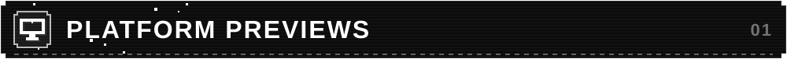

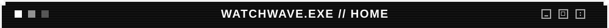  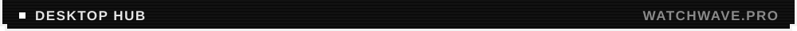

> **Desktop Hub:** Experience a fast, grid-based dashboard designed for desktop monitors. Browse trending releases, jump into personalized recommendations, or manage your continue watching queue with full keyboard and mouse navigation.

 

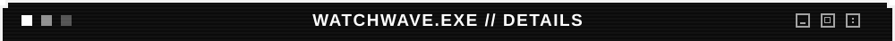  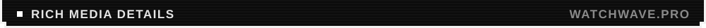

> **Rich Media Details:** Dive deep into full movie, TV show, and anime metadata powered by TMDB and AniList. View episode guides, cast listings, high-definition backdrops, and language audio selections instantly before launching playback.

 

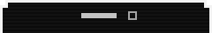  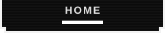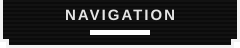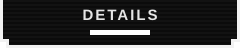

> **Mobile Interface:** Optimized for on-the-go streaming on Android devices. Features smooth gesture navigation, responsive touch controls, instant Sub/Dub toggles, and direct file/torrent downloading for offline viewing.

 

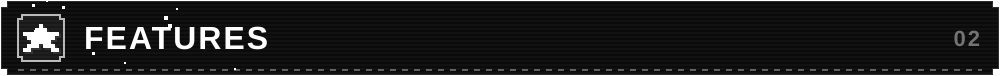

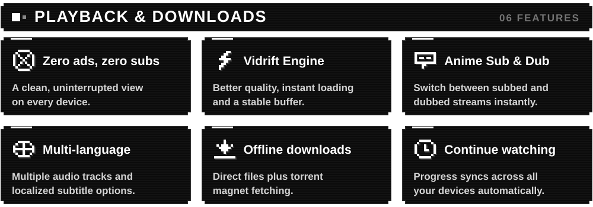

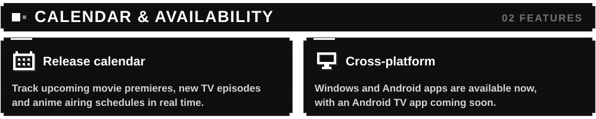

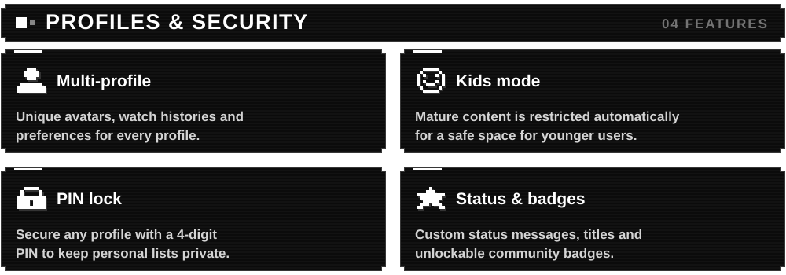

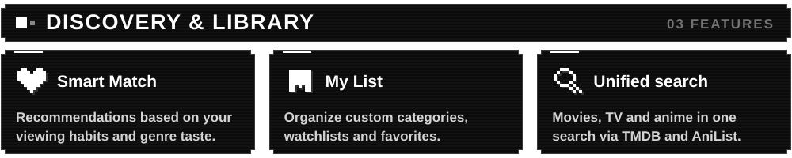

 

 

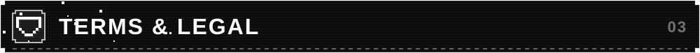

### 1. License & Usage

Copyright © 2026 **WatchWave**. All Rights Reserved.

- **Usage Right:** WatchWave is proprietary, closed-source software provided free of charge strictly for personal, non-commercial use.
- **Distribution Restrictions:** You may download and install WatchWave on supported devices. You may **not** decompile, reverse engineer, modify, redistribute, re-upload, or resell WatchWave, its source code, or its compiled binaries without explicit written permission.

### 2. Legal Disclaimer & Content Aggregation

- **No Content Hosted:** WatchWave does not host, store, upload, archive, or manage any video content, media files, streaming servers, or database files on its own infrastructure or servers.
- **Aggregator Service:** WatchWave acts purely as a search and indexing tool that aggregates third-party links, metadata, and web embeds publicly accessible on the internet.
- **Third-Party Sources:** All media content is provided directly by unaffiliated third-party services. WatchWave has no control over, responsibility for, or affiliation with any third-party content providers or media hosts.
- **Liability Notice:** WatchWave does not verify the legality or accuracy of content made available by external third-party sources. Users are solely responsible for their compliance with local laws and regulations regarding online media viewing.
